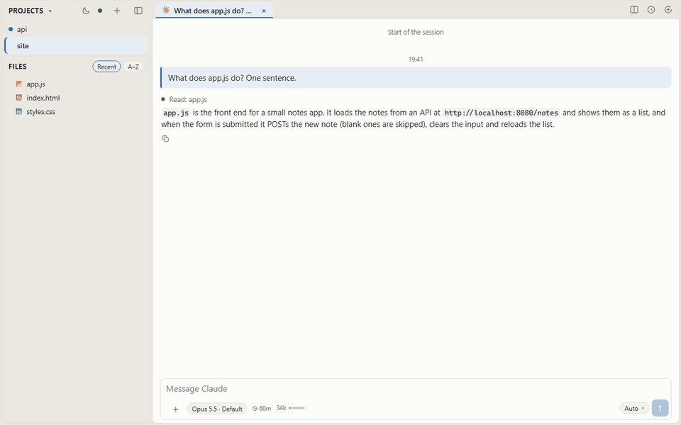
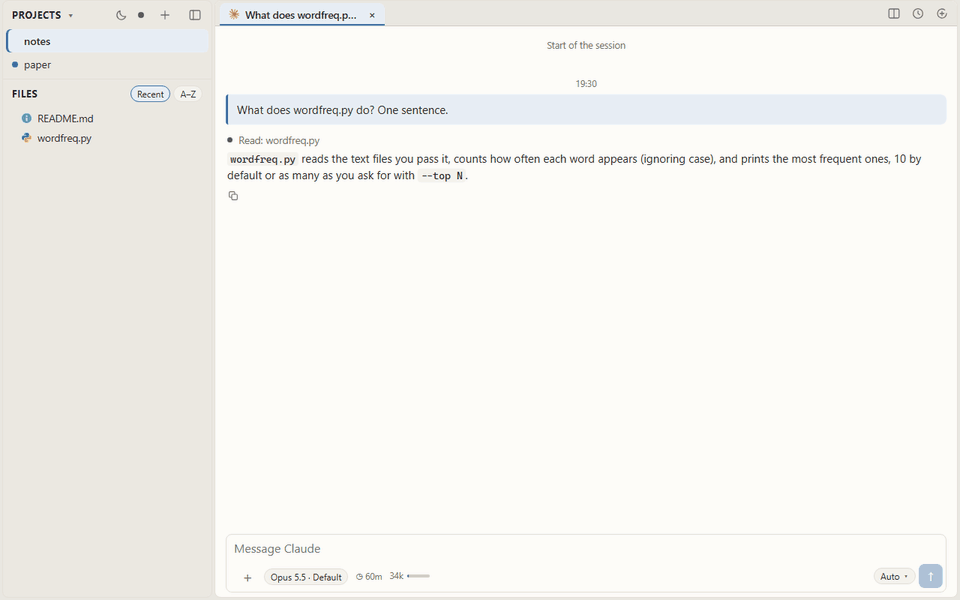

# Dakort

All your Claude Code and Codex projects in one light window, with the
files beside the agent.



Dakort is a small server on your own computer and a page in your browser.
Each project is a browser tab.

Inside Dakort, a project's Claude Code and Codex sessions are tabs, and
the files the agent is working on can also open beside the conversation.

When an agent finishes, the browser tab's icon changes, so you can see
from the tab strip which project wants you. The same page opens on your
phone over Tailscale.

A session started in a terminal appears in Dakort, and one started in
Dakort can be resumed in the terminal.

## Why

Try four projects at once, each with three or four Claude Code sessions,
without Dakort. In the terminal that is a dozen windows, and nothing
tells you which one just finished. In VS Code it is four heavy windows
with the agent in a side panel.

Claude Desktop is session-centric. Its sidebar is one list of a dozen
sessions, each with a folder attached, and it lists only the sessions it
started itself. Codex's apps have a shape of their own, so someone on
both agents learns two of everything. And a LaTeX or Word project gets
no view of its files anywhere.

Dakort is project-centric, which is how Claude Code and Codex store your
work anyway. A project is a browser tab. Inside it, its sessions are
tabs, from either agent, started here or in a terminal, with its files
beside them. The browser tab's icon says when one of its agents is done,
so the tab strip alone tells you which project wants you. One page for
both agents, one Go binary with the page inside, no Electron, nothing
else to install. The CLIs run only while a turn runs.

## What you get

- **Projects as browser tabs.** Each with its own session tabs and files.
  A project whose agent is working, or finished since you looked, shows
  it in its row, its session tab and the browser's tab icon.
- **Claude Code and Codex.** Model, effort and permission mode per
  session. Permission requests are cards: Allow or Deny.
- **Files beside the agent.** Code, editable and saved with Ctrl+S.
  PDFs with search and SyncTeX both ways. Word documents as pages. CSV as
  tables. Images, SVG, video, audio. Archives as a tree. A file the agent
  changes re-renders at once.
- **An eye on cost.** Each session shows how full its context is and how
  long its prompt cache stays warm, which is what decides what the next
  message costs. A big session left idle is compacted before the cache
  goes cold, so coming back after a break is cheap. On by default, off
  per session.
- **Alongside the terminal.** A session you drive in the terminal shows
  live, marked as open elsewhere so you do not write to it twice. Deleted
  sessions go to a trash with undo.
- **The same page on a phone.** One pane, the explorer as a drawer, the
  same tabs. Light and dark themes.

## Install

### macOS

```
brew install dakort-app/tap/dakort
dakort setup
```

### Windows

With [Scoop](https://scoop.sh):

```
scoop bucket add dakort https://github.com/dakort-app/scoop-bucket
scoop install dakort
dakort setup
```

With winget, once Microsoft has reviewed the package (some days after a
release):

```
winget install dakort
dakort setup
```

Or unzip the Windows archive from the
[release page](https://github.com/dakort-app/dakort/releases) anywhere
and run `dakort setup` from there. SmartScreen warns the first time; the
binary is not code-signed yet.

### Linux

From the [release page](https://github.com/dakort-app/dakort/releases):
a `.deb` for Debian and Ubuntu, an `.rpm` for Fedora and friends, a
`.tar.gz` for the rest. amd64 and arm64.

```
sudo apt install ./dakort_*_linux_amd64.deb
dakort setup
```

### What setup does

Installs Dakort as a service that starts when you log in. Finds the
Claude Code and Codex CLIs. Shows your phone's address as a QR code and
opens the page, which asks you to choose a password.

`dakort setup -uninstall` removes the service; your sessions stay. On
Windows, `dakort setup -at-boot` runs it before anyone logs in, for a
machine nobody signs in to. Codex's shell commands do not work there; its
sandbox needs a signed-in desktop.

### The phone or other device

Dakort reaches your phone or other device through [Tailscale](https://tailscale.com), a
private network between your own devices. It is free for personal use
and needs no router settings, no port forwarding and no public address.
Nothing is exposed to the internet; only devices signed in to your
Tailscale account can see the computer at all.

1. Install Tailscale on the computer and on the phone, from
   tailscale.com/download or the app store, and sign both in with the
   same account (a Google account, say).
2. Run `dakort setup` on the computer. It prints the URL to open on the phone or other device and
   a QR code.
3. Scan the code with the phone, or type the address. The page asks for
   the password you chose on the computer, once per device.

If Tailscale came after Dakort, run `dakort setup` again and it picks the
tailnet up.

The connection is encrypted by Tailscale itself; the page
goes over plain HTTP inside it. For HTTPS on the tailnet, with the lock
icon, `dakort setup -https` puts it behind Tailscale Serve, which needs
HTTPS certificates enabled in your Tailscale admin console.

### Updating

Dakort updates itself. When a newer release has been out for an hour, the
service fetches it, checks it against the release's checksums, and
restarts with it once nothing is running. Nothing to press, nothing to
read. The version you are on is at the foot of the Open project sheet.

To keep that in your own hands, run `dakort setup -auto-update=false`
once. Then, when the page says a release is out:

```
dakort update
```

After an update through brew, winget or scoop, run `dakort setup` again
instead, so the service takes the new copy.

## What it needs

Claude Code or Codex, or both. They are the agents; Dakort is the page
around them and has no keys or accounts of its own. If you already use
one of them in a terminal, there is nothing to do here: your sessions
are already Dakort projects.

### Claude Code

Needs a Claude Pro, Max, Team or Enterprise plan, or an API key. The free
plan does not include it. Install it with the command for your system,
from [Anthropic's own page](https://code.claude.com/docs/en/setup):

```
curl -fsSL https://claude.ai/install.sh | bash      # macOS, Linux

irm https://claude.ai/install.ps1 | iex             # Windows, in PowerShell
```

Then open a terminal in a project folder, run `claude`, and sign in in
the browser window it opens. Say hello to it once. That folder is now a
project in Dakort, with that session in it.

### Codex

Needs a ChatGPT Plus, Pro, Business, Edu or Enterprise plan, or an API
key. From [OpenAI's own page](https://github.com/openai/codex):

```
curl -fsSL https://chatgpt.com/codex/install.sh | sh                                     # macOS, Linux

powershell -ExecutionPolicy ByPass -c "irm https://chatgpt.com/codex/install.ps1 | iex"  # Windows
```

Then run `codex` in a project folder and choose "Sign in with ChatGPT".

If you install an agent after Dakort, run `dakort setup` again so it
finds it. The page also says which command to run if you send a message
to an agent that is not installed.

### Tailscale

For the phone/other device only. [Tailscale](https://tailscale.com) on the computer
and the phone/other device, as described under Install. Without it, Dakort listens on
the computer only, and picks Tailscale up when it is installed later.

## How it works

The server reads the session files Claude Code and Codex keep, and watches
them, so a terminal session shows as it goes. Each message you send runs
the CLI for one turn in the project's folder, `claude -p --resume` or
Codex's app-server, and streams the result.

It listens on this computer and your Tailscale addresses only; other
addresses are refused unless you ask. The page is behind a password you
choose, or the token link setup prints on the computer. The only outward
request is to GitHub's releases every six hours, for the update notice.

## Questions

### How is this different from Claude Desktop?

Claude Desktop is session-centric. It is one window with one list of
sessions, each with a folder attached, and the list holds only the
sessions it started itself. 

Dakort shows every session the CLIs have on
disk, Claude Code and Codex, grouped by project, with the project's files
beside them, and the same page opens on a phone. 


### Does it change my Claude Code or Codex setup?

No. It reads the session files the CLIs keep and runs the CLIs for each
turn, so the sessions are written by the CLIs, as in a terminal.
Uninstalling removes the service and leaves your sessions where they
were.

### Does the computer have to stay on?

Yes. The agents run on it, and Dakort is the page in front of them. The
phone is a window, not a second computer.

### What if Claude Code or Codex asks me to sign in again?

The page offers the sign-in. It shows the agent's own sign-in link, and
either takes the code the Claude page gives you or shows the code the
Codex page asks for. Both work from the phone. Signing in from a
terminal on the computer works too, as always.

### How do I uninstall it?

Two steps. First `dakort setup -uninstall`, which stops the service and
removes it. Then remove the program the way it came: `brew uninstall
--cask dakort`, `scoop uninstall dakort`, or delete the binary on Linux.

Your Claude Code and Codex sessions are not touched; they belong to the
CLIs. What stays behind is Dakort's own small folders, the password and
token in the config folder and the logs in the cache folder, named
`dakort` under the system's usual places (`%APPDATA%` and
`%LOCALAPPDATA%` on Windows, `~/Library/Application Support` and
`~/Library/Caches` on macOS, `~/.config` and `~/.cache` on Linux).
Delete them by hand if you want nothing left.

## Building from source

Go 1.27 and Node 22.

```
cd web && npm ci && npm run build && cd ..
go build ./cmd/dakort
```

## LaTeX

If you write LaTeX, the PDF opens beside the agent and re-renders as it
recompiles, with SyncTeX both ways:



## License

MIT.
